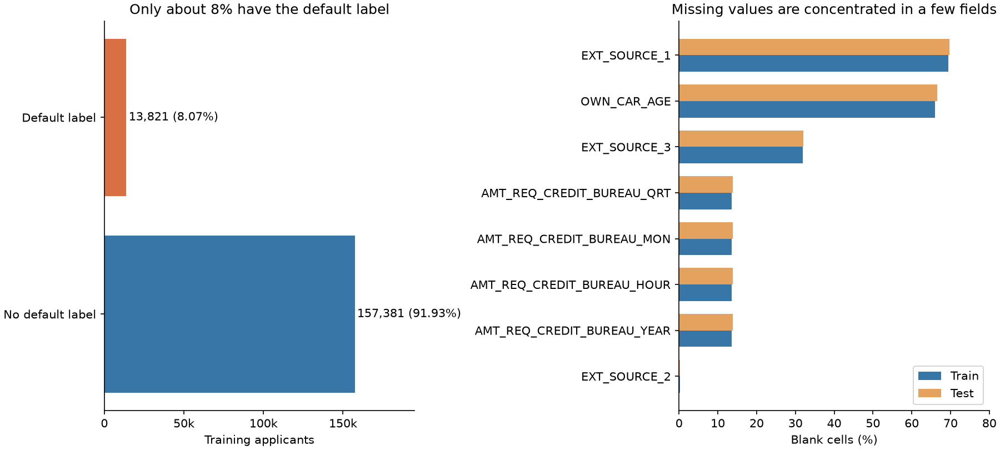
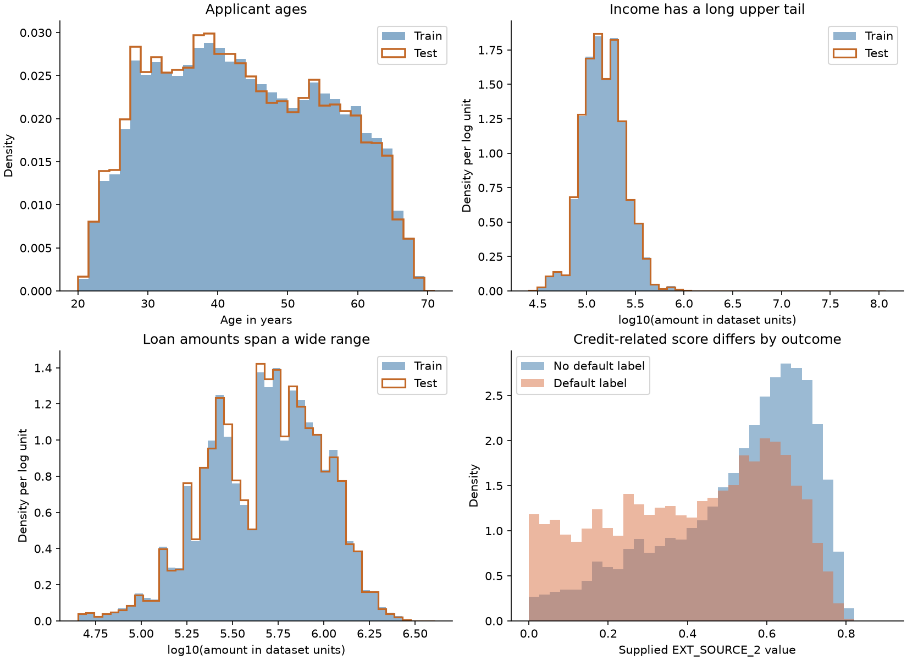
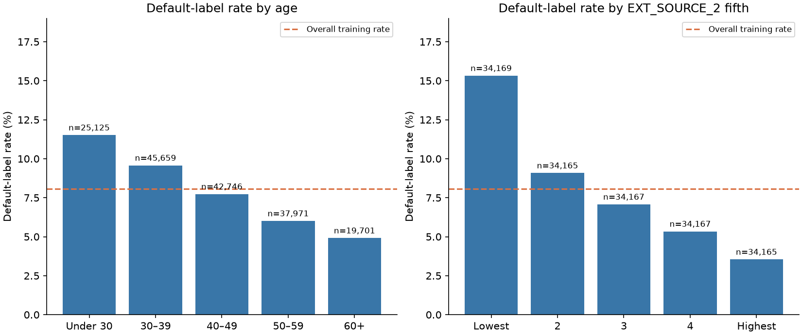

# Data audit and exploratory analysis

**EDA means exploring the data before deciding what to model.** It asks what the
rows contain, what looks unusual, which values are missing, and what patterns
appear in the known outcomes. This report explains the findings separately from
the model-tuning history.

The work already existed in [the first data-audit notebook](../notebooks/01_competition_data_audit.ipynb)
and [the later opportunity audit](../../round5/notebooks/07_signal_opportunity_audit.ipynb),
with additional [loan-structure EDA in Round 2](../../../improvements/round2/proxy_eda.py).
For this standalone report, descriptive tables and plots were refreshed from the
same supplied CSVs. The recorded train/test classifier and later saved-model
diagnostics were reused. **No new model was trained, no source data changed, and
no existing notebook was edited.**

## Main findings

- **The labels are imbalanced:** 8.07% show payment difficulties, versus 91.93% that do not.
- **Missing data are common:** roughly 69% of external score 1 and 66% of car age are blank.
- **Employment has a special code:** 365243 appears in 30,898 training rows; it is not a realistic duration.
- **Credit-related scores contain useful associations:** lower EXT_SOURCE_2 groups have higher observed default-label rates.
- **Some groups are tiny:** their extreme-looking rates are unreliable summaries.
- **The measured train/test differences were modest:** this supports, but does not prove, the validation approach used.

## 1. What data do we have?

| Property | Finding |
| --- | --- |
| Training applicants | 171,202, with known outcomes |
| Test applicants | 61,500, without outcomes |
| Supplied predictors | 32: 24 numeric, 8 categorical |
| Default label / no default label | 13,821 / 157,381 |
| Target meaning | Payment difficulties as defined by the supplied task; “default” is shorthand here |
| Extra external data | None |

All outcome rates below describe **the labeled training data**. We cannot measure
the test set's default rate because its labels are unavailable. “External” in
`EXT_SOURCE_1/2/3` is part of the supplied column names; those columns were already
in the CSV, not fetched online. Amounts are shown in dataset units; no currency
or payment-period assumption is introduced.



**Why the imbalance matters:** predicting “no default” for everybody would give
91.93% accuracy but catch nobody with the default label. We therefore evaluated
risk ranking with ROC AUC and used stratified validation groups that preserve a
similar class proportion. We did not delete repayers or manufacture default cases
to make the descriptive data look balanced.

## 2. Are there obvious integrity problems?

The checks found no repeated IDs within either file, no overlapping train/test
IDs, no exact repeated predictor profiles within either file, and no matching
train/test predictor-profile hashes. The train/test feature names and order
match, after removing TARGET. TARGET contains only 0 and 1, and no raw numeric
infinities were found.

Train IDs run from 0 to 171201;
test IDs from 171202 to 232701.
Those ranges would trivially identify which file a row came from. IDs were kept
for submission alignment and excluded from predictive and train/test-difference
models. An ID check does not recover a person's identity or establish that two
similar applicants must be the same person.

### The employment placeholder

`DAYS_EMPLOYED=365243` occurs in **30,898 training
rows (18.05%)** and
**10,565 test rows (17.18%)**.
That would be about a thousand years, so models treated it as missing and
engineered inputs kept a separate indicator. Ordinary negative day counts were
not automatically removed: they encode time before a reference date. Age was
interpreted as `-DAYS_BIRTH / 365.25`, giving a training range of approximately
21.0–69.1 years.

The ORGANIZATION_TYPE label `XNA` matches the employment-placeholder rows exactly
in both files: **yes**.
This pattern is structured rather than an arbitrary collection of empty cells.
The description does not establish why each individual value is unavailable.

Literal category values are distinguished from empty cells. For example,
OCCUPATION_TYPE contains the category `Other`; we did not assume it was a blank
or replace it. Explicit `XNA`/`Unknown` labels were retained as categories where present;
some individual category levels have very few examples.

## 3. Which information is missing?

The following percentages count raw blank/NaN cells, **before** recoding the
employment placeholder. Explicit labels such as `XNA` are not counted as blanks.

| Field | Missing in train | Missing in test |
| --- | --- | --- |
| EXT_SOURCE_1 | 69.47% | 69.78% |
| OWN_CAR_AGE | 66.00% | 66.52% |
| EXT_SOURCE_3 | 31.88% | 32.02% |
| AMT_REQ_CREDIT_BUREAU_QRT | 13.50% | 13.84% |
| AMT_REQ_CREDIT_BUREAU_MON | 13.50% | 13.84% |
| AMT_REQ_CREDIT_BUREAU_HOUR | 13.50% | 13.84% |
| AMT_REQ_CREDIT_BUREAU_YEAR | 13.50% | 13.84% |
| EXT_SOURCE_2 | 0.22% | 0.21% |
| CNT_FAM_MEMBERS | 0.00% | 0.00% |

Dropping every applicant with any blank would discard substantial information.
The modeling response was to retain rows, preserve missingness where supported,
and test appropriate missing-value methods. Neural preprocessing used medians
learned within training folds and missing indicators. Missing car age was not
automatically interpreted as “does not own a car.”

Applicants also differ in how many of the three supplied external scores are blank:

| Missing external scores | Applicants | Default-label rate |
| --- | --- | --- |
| 0 | 36,164 | 7.11% |
| 1 | 96,310 | 8.04% |
| 2 | 38,611 | 9.06% |
| 3 | 117 | 9.40% |

These observed rate differences are descriptive. They do not imply that adding
or removing a score causes default, or that a guessed missing value is the truth.

## 4. What do the distributions look like?



“Density” normalizes each histogram separately so we can compare shapes. Equal
areas in the two outcome histograms do not mean the two classes contain equal
numbers of applicants; their actual counts are shown in the first figure.

The amount variables have long right tails: a small number of applicants have
much larger values than the typical applicant. For example:

| Field | Train median | Train 99th percentile | Train maximum | Test maximum |
| --- | --- | --- | --- | --- |
| AMT_INCOME_TOTAL | 146,250 | 463,500 | 13,500,000 | 117,000,000 |
| AMT_CREDIT | 514,602 | 1,868,802 | 4,050,000 | 3,860,019 |
| AMT_ANNUITY | 24,916 | 70,132 | 170,986 | 170,986 |

The income and loan charts use log10 values so the tails remain visible. A step
of one on that axis means ten times the amount. The charts retain all positive
values rather than silently deleting the extremes. Large amounts alone are not
proof of a data-entry error. Ratios, regularized learners and neural quantile
preprocessing were tested instead of assuming every large observation was invalid.

Individual test values can still exceed the observed training range: the largest
test income is 117 million, versus 13.5 million in training. Similar bulk
distributions do not remove the need to notice rare extremes. These observations
were reported rather than automatically corrected to an invented value.

Several fields are strongly related. These are the five largest absolute
Spearman correlations among numeric predictors after masking the employment sentinel:

| Numeric fields | Spearman correlation |
| --- | --- |
| AMT_CREDIT / AMT_GOODS_PRICE | 0.985 |
| AMT_CREDIT / AMT_ANNUITY | 0.830 |
| AMT_ANNUITY / AMT_GOODS_PRICE | 0.828 |
| CNT_CHILDREN / CNT_FAM_MEMBERS | 0.812 |
| DAYS_BIRTH / FLAG_EMP_PHONE | 0.600 |

Spearman correlation describes whether values tend to increase/decrease together.
It does not prove causation or show that one of the columns can safely be removed.
The full matrix is in [numeric_spearman.csv](eda/numeric_spearman.csv).

## 5. Which groups have different observed outcomes?

The strongest simple example is the supplied EXT_SOURCE_2 score. Splitting
applicants with an observed score into five similarly sized groups gives:

| EXT_SOURCE_2 group | Applicants with observed score | Default-label rate |
| --- | --- | --- |
| Lowest fifth | 34,169 | 15.32% |
| Fifth 2 | 34,165 | 9.08% |
| Fifth 3 | 34,167 | 7.07% |
| Fifth 4 | 34,167 | 5.34% |
| Highest fifth | 34,165 | 3.54% |

Higher score groups have lower observed default-label rates here. That is a
useful association for prediction, not proof that changing the score would
change an applicant's outcome. Missing-score applicants are excluded from this
particular five-group table and are covered in the missingness tables above.



The orange dashed line is the overall training rate, not a policy threshold.
Age groups and contract types also differ:

| Contract | Applicants | Default label | Rate |
| --- | --- | --- | --- |
| Cash loans | 154,988 | 12,921 | 8.34% |
| Revolving loans | 16,214 | 900 | 5.55% |

The full [category table](eda/category_rates.csv) includes income, education,
housing, occupation, organization and other supplied categories, with counts and
flags for groups having fewer than 100 examples of either outcome. For example,
“Maternity leave” contains only three training applicants, with one default label.
Its 33.33% rate is not a reliable estimate for a wider population. Groups can also
differ in loan mix, age and other characteristics; these comparisons do not
isolate an individual variable's effect.

### Loan/payment patterns explored in Round 2

A separate earlier EDA examined `AMT_CREDIT / AMT_ANNUITY` on the **136,961
development rows**, rather than the full training population used in the tables
above. Its recorded groups were:

| Loan/payment ratio group | Development applicants | Default-label rate |
| --- | --- | --- |
| (6.0, 12.0] | 15,854 | 5.28% |
| (12.0, 18.0] | 27,293 | 10.30% |
| (18.0, 24.0] | 48,974 | 9.25% |
| (24.0, 36.0] | 39,082 | 6.68% |
| (36.0, 48.0] | 5,758 | 4.65% |

The relationship was not simply “a larger ratio always means more defaults.”
This motivated testing loan-structure features. The ratio is **not a verified
loan term in months**, because actual terms and payment assumptions are not
fully supplied. Distances from nearby multiples of 6 and 12 were also examined;
their outcome patterns motivated later feature experiments, whose usefulness
still required model validation.

The original [binned table](../../../improvements/round2/artifacts/credit_term_development_bins.csv),
[plot](../../../improvements/round2/artifacts/loan_structure_development.png), and
[distribution-check record](../../../improvements/round2/artifacts/loan_structure_distribution_check.json)
are preserved. Its error bars describe sampling uncertainty within bins, not
uncertainty from feature selection or differences in applicant composition.

## 6. Do train and test appear different?

The original audit compared blank rates, numeric distributions, category shares
and a classifier trained to distinguish train rows from test rows, excluding ID.
That diagnostic classifier's recorded AUC was **0.518898**.
An AUC near 0.5 means that particular classifier had limited ability to distinguish
the files. It does not prove equal distributions, equal default rates or absence
of hidden shifts. We reuse the recorded result; no classifier was refitted here.

The largest recorded numeric KS differences were:

| Field | Largest CDF difference (KS) |
| --- | --- |
| EXT_SOURCE_3 | 0.0293 |
| EXT_SOURCE_2 | 0.0226 |
| EXT_SOURCE_1 | 0.0220 |
| DAYS_BIRTH | 0.0138 |
| OWN_CAR_AGE | 0.0124 |

A KS value of 0.0293 means the largest gap between the two cumulative distributions
was about 2.93 percentage points. It is not an AUC or default-rate difference.
Raw blank rates were also close for the heavily missing fields. Category-share
differences and unseen-category counts are in
[categorical_shift.csv](eda/categorical_shift.csv).

Together, the measurements supported stratified random validation as a reasonable
working choice. They did not establish that performance would transfer perfectly.

## 7. What did the later error audit add?

This was a **model-error audit**, separate from basic data exploration. It reused
the older round-three ensemble's saved validation predictions on **136,961**
development rows, with AUC **0.76480**. These are already explored labels,
not an independent new test. No model was fitted or predictions changed in that audit.

One group was missing two external scores: it contained **30,767**
applicants and had within-group AUC **0.74395**. Although that AUC was
lower, the group accounted for **23.09%** of
ranking errors attributed to positive applicants, compared with **25.24%**
of all positive applicants. In plain language: a weak-looking score on one group
did not show that the group was an unusually large source of the overall problem.

“Within-group AUC” evaluates only applicants inside that group. To judge its
overall importance, the audit also counted its contribution to all ranking errors.

Most contract-group ranking errors occurred within the large groups. This did
not identify a tiny, obviously broken segment whose correction would explain a
large overall score jump. The findings motivated broader model/representation
experiments rather than manually changing predictions for particular people.

One saved CatBoost model scored **0.81409** on a
20,000-row sample of its own training data, versus **0.76518**
on its held-out rows. That illustrates a generalization gap. The higher training
score is not a leaderboard prediction or proof that 0.8 is achievable.

See [the later audit notebook](../../round5/notebooks/07_signal_opportunity_audit.ipynb)
and its [group tables](../../../improvements/high_upside/artifacts/group_slices.csv)
for the full decomposition.

## 8. What did we decide because of the EDA?

| Observation | Practical response |
| --- | --- |
| Imbalanced labels | Use ranking metrics and stratified validation; retain the original outcome distribution |
| Many missing scores and car ages | Retain rows, represent missingness and fit preprocessing inside training folds |
| Invalid employment duration | Mask the placeholder and preserve an indicator |
| Related financial amounts | Test ratios such as income/payment and loan/payment against raw-column controls |
| Different external-score values and availability | Test score summaries and later learned reconstructions using only supplied data |
| Tiny categories | Show counts and avoid strong claims from extreme-looking small-sample rates |
| Modest measured train/test differences | Use random stratified validation while acknowledging unobserved shift remains possible |
| No obvious small error segment explaining a large gain | Prioritize generalization across the population instead of hand-adjusted subgroup predictions |

These were hypotheses and safeguards, not guarantees. Feature/model validation
was still needed to determine whether a change helped. The original audit labels
have since been inspected repeatedly, so they cannot now be described as untouched.

## Tables, provenance and reproduction

- [All 32 predictors: types, missingness, distinct values and numeric percentiles](eda/feature_profile.csv).
- [All category counts and default-label rates](eda/category_rates.csv),
  [age groups](eda/age_rates.csv), [external-score groups](eda/external_score_bins.csv).
- [Data-quality summary and input/source SHA-256s](eda/quality_summary.json).
- Original [numeric train/test comparison](../../../improvements/artifacts/numeric_shift.csv),
  [recorded initial audit](../../../improvements/artifacts/data_audit.json),
  [later audit summary](../../../improvements/high_upside/artifacts/audit_summary.json).
- [Report builder](../../../tools/build_eda_report.py).

From the repository root:

```sh
Competition/.venv/bin/python Competition/tools/build_eda_report.py
```

This computes descriptive summaries and figures from the supplied files and reads
recorded audit evidence. It does not train models, tune a candidate, edit a notebook,
change predictions or modify the input CSVs. Observed associations are not causal
findings, fairness guarantees, a performance ceiling or evidence about other entrants.
