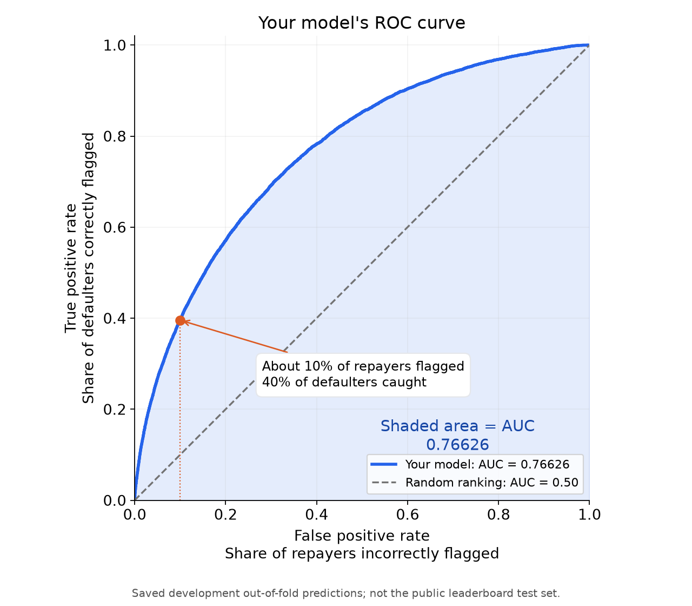

# Model selection: what we tried, why, how, and what won

**Main conclusion:** we chose a weighted mixture because it ranked applicants
better than its complete previous reference in matched local comparisons. The
latest recipe is **25% older tree ensemble + 37.5% TabM neural model + 37.5%
score-reconstruction CatBoost**. The new neural model was weaker by itself than
the old mixture, but added useful complementary ranking information.

Matched three-seed local AUC improved **0.76480 →
0.76626**. The latest user screenshot shows public AUC
0.77029, rank 364, but does not explicitly identify the uploaded filename.
Neither that observation nor the training scores establish a maximum attainable
score or demonstrate 0.8. This report reads saved evidence; it trains no models.

Read [dataset enhancement](../../round2/reports/DATASET_ENHANCEMENT_REPORT.md)
for input formulas, and [EDA](../../round1/reports/EDA_REPORT.md) for the data
observations. Here the focus is **which models/combinations earned their cost**.

## 1. How to read the scores

ROC AUC is the competition metric: higher means better ordering of default versus
repayment cases. A constant score gives AUC .5 even if predicting “repay” for
everyone gets approximately 92% accuracy. We therefore did not select by accuracy.

| Evaluation | Meaning | Appropriate use |
| --- | --- | --- |
| Inner screen | Train on 102,720 rows; score 34,241 development rows | Quickly shortlist hypotheses; repeatedly explored |
| Development five-fold CV | Hold out each part of 136,961 development rows in turn | Compare candidates on common folds and score pooled held-out predictions |
| New partition / seed | Repartition the same development labels | Check robustness; not an independent new test |
| First audit | Originally held-out 34,241 rows | Historical initial evaluation; later explored, so no longer untouched |
| Full-data OOF | Held-out predictions across final training folds | Diagnostic after selection; not a new independent estimate |
| Public leaderboard | Platform score on an unknown test subset | Record actual submissions; not a label source or large search grid |

Compare scores **within the same evaluation row/stage**. A pilot AUC near .75 and
a public AUC near .77 are not a measured .02 improvement. Fold scores are pooled
over their held-out predictions for the main AUC, rather than simply averaging
five separate AUC numbers. Differing fold-model score scales can affect pooling.

The row groups were stratified: each retained roughly the same default/non-default
proportions. This helps avoid a misleading comparison caused by one validation
group containing substantially fewer of the rare default cases.

Average precision checks retrieval of the rarer default cases. Log loss and Brier
score check probability quality; lower is better for those two. ROC AUC remained
the selection objective, with secondary metrics retained as diagnostics.

## 2. What model families were tried?

The models below use their recorded feature/preprocessing recipes. This compares
recipes, not a perfectly controlled isolation of algorithm identity. “Not advanced”
means the later stage was not run; it is not an invented CV result.

| Recorded recipe | Inner-screen AUC | Pooled development CV AUC | Role |
| --- | --- | --- | --- |
| Tutorial Random Forest (five supplied columns) | 0.6599833 | Not run | Baseline; not an exhaustive RF study |
| Logistic, C=.01 | 0.7329595 | Not advanced | Linear baseline; preprocessing/inputs differ from trees |
| Spline/logistic, C=.1 | 0.7365373 | 0.7483044 | Different smooth representation; not retained |
| Histogram boosting, 20 leaves | 0.7416091 | 0.7532918 | Validated; not retained |
| LightGBM, raw | 0.7367838 | 0.7499471 | Control |
| LightGBM, engineered | 0.7440631 | 0.7561022 | Feature control |
| LightGBM, tuned/group frame | 0.7471511 | 0.7573281 | Retained reference family |
| CatBoost, lean | 0.7484926 | 0.7607901 | Selected first-pass family |
| XGBoost, finance | 0.7472249 | 0.7588833 | Validated; not retained |
| CatBoost, compact proxies | 0.7499521 | 0.7622544 | Retained reference family |
| CatBoost, native-missing proxies | 0.7496474 | 0.7615745 | Retained complementary family |
| CatBoost, signed frame | 0.7509073 | 0.7628502 | Retained reference family |
| CatBoost, signed/512 borders | 0.7508544 | 0.7626619 | Retained reference family |
| Early MLP, small | 0.7271761 | Not advanced | No screened blend improvement |
| Early MLP, wider | 0.7345608 | Not advanced | No screened blend improvement |

**Why these families:** Random Forest supplied the tutorial-equivalent starting
point; its five-column setup was not an exhaustive Random Forest comparison.
LightGBM, CatBoost, histogram boosting and XGBoost tested alternative boosted-tree
recipes. Logistic and spline models tested simpler/ smoother relationships.
MLPs and later TabM tested a different learned representation and potential error
complementarity. The observed results decide their roles; the reasons a loser
might struggle are hypotheses, not proof that the whole family is unsuitable.

## 3. What was tuned, and why?

Depth/leaves control interaction capacity; minimum leaf/child size limits tiny
groups; L2/L1 penalties discourage unstable fits; feature/row sampling and split
noise can reduce reliance on a particular sample; quantization controls candidate
numeric split boundaries; learning rate controls update size. More capacity can
fit extra structure or noise, so validation—not the size of the model—decided.

The first LightGBM search ran 24 Optuna configurations across feature modes,
group statistics, leaves, child counts, row/column sampling, regularization and
numeric bins. Its chosen trial was a **joint recipe**: the improvement cannot be
attributed to one parameter. CatBoost trials varied depth/regularization, borders,
category handling, growth policies, missingness, features and class weights.
Class weighting gives defaults extra influence in the loss; it was tested but
did not earn a place in the retained recipes. No row balancing was applied.

An epoch is a neural pass over training rows; a boosting iteration adds another
tree. Screening/primary CV used validation-based early stopping. Later fits used
fixed counts selected before confirmation. The full trial settings and outcomes
are in the [full experiment catalog](../../../docs/EXPERIMENT_CATALOG.md) and [decision matrix](selection/model_decision_matrix.csv).

## 4. How the earlier ensemble was built

**Round 1:** lean CatBoost had pooled development AUC .7607901; tuned/group
LightGBM had .7573281. Their **2/3 CatBoost + 1/3 LightGBM** mixture reached
.7617724. The benefit of combining them, rather than picking one by standalone
score, supported retaining both. The original audit scored .7555056 versus
.6665727 for the tutorial-equivalent baseline. Those audit labels were later
inspected and are not now an untouched test.

**Round 2:** compact loan proxies and native-missing proxies were compared against
the complete first recipe. The selected weights were **.1875 LightGBM + .5625
proxy CatBoost + .25 native-missing proxy CatBoost**. Primary development AUC
rose **0.7617724 → 0.7630891**. A fixed-count new partition
also improved by **0.0014518**, with all five groups positive.
Two-seed averaging retained the common family recipe and reduced sensitivity to
one partition. A new partition still uses previously explored labels.

**Round 3:** the signed-feature CatBoost and a signed/512-border CatBoost were
added at .25 each, with .5 retained for the round-two mixture. Primary gain was
**0.0006338**, fixed-count confirmation gain **0.0008462**, and
matched two-seed gain **0.0006131**. The latter comparisons passed
their recorded gates. The 512-border recipe uses the successful signed frame;
it is not an importance-pruned feature subset despite its short trial name.

The third-seed check increased candidate development AUC by approximately
**0.0002194**, with no reweighting or seed-subset search.
The resulting older reference has five families × three seeds × five folds =
75 primary saved models. Its expanded family weights are .09375 LightGBM,
.28125 proxy CatBoost, .125 native-missing proxy CatBoost, .25 signed/512-border
CatBoost and .25 signed CatBoost.

**What did not earn expansion:** early small/wider MLPs did not improve a screened
blend. A learned-logit stacking feasibility probe over the older families added
only **0.00000249**, below its .00020 trigger for expensive nested
validation. The base predictions were not fully nested, so that probe was not
eligible for submission. It does not settle fully nested stacking of newer families.

## 5. Why the search changed direction

Round 4 completed seven nearby CatBoost screens. The best screened mixture gain
was about .0002437, and no downstream validation/submission was completed before
the user prioritized larger gains. The recorded work was retained rather than
presenting the interrupted branch as a completed negative result.

The opportunity audit found a training/held-out gap for one saved model and no
obvious tiny subgroup explaining a large global ranking deficit. The response
was to test new representations/model families across the population. This did
not establish that a larger architecture would reach .8, or that more depth
could never help. The old incremental sweep stayed stopped.

## 6. The six structural pilots and promotion decisions

All six exact recipes were recorded before their pilots. Each screened its own
performance and five probability-blend weights (.10/.25/.50/.75/1.00) against the
complete current reference, whose inner AUC was .7518409. Promotion allowed at
most one neural and one learned-feature CatBoost family, each needing at least
.00030 screened blend gain.

| Structural pilot | Standalone inner AUC | Best screened blend gain | Decision |
| --- | --- | --- | --- |
| hu_tabm_raw_piecewise | 0.7401112 | +0.0002394 | Not advanced |
| hu_tabm_signed_piecewise | 0.7508052 | +0.0015386 | Advanced |
| hu_tabm_signed_periodic | 0.7481982 | +0.0009184 | Not advanced |
| hu_tabm_regularized | 0.7501469 | +0.0009786 | Not advanced |
| hu_cat_score_reconstruction | 0.7507566 | +0.0003659 | Advanced |
| hu_cat_interaction_risk | 0.7453797 | -0.0001325 | Not advanced |


The signed piecewise TabM was the best neural contribution. Raw inputs were
weaker; periodic embeddings and the stronger-regularized full-TabM recipe did not
beat the chosen contribution. The latter changed several settings jointly, so
its result does not isolate dropout, learning rate or architecture individually.

Reconstruction CatBoost passed the learned-feature slot. Interaction-risk encoding
reduced the screened mixture AUC and was rejected. Auxiliary score R2 alone did
not decide promotion. A useful representation had to help default-risk ranking.

Not every positive pilot advanced: a capacity limit reserved only the best model
in each slot. A screen win was not sufficient to ship a CSV.

## 7. How the final weights were selected and checked

The two finalists ran on the same primary development folds as the reference.
The declared grid compared reference/new and new/new pairs, plus three-way
mixtures, with probability and log-odds averages. The saved grid contains
**61** recipes, not an unreported post-confirmation search.
The winner uses probability averaging.

Pair shares were .10, .25, 1/3, .50, 2/3, .75 and .90. Three-way recipes tested
reference shares .25/.50/.75 and relative shares .25/.50/.75 for the two additions.
For the winning reference share .25 and equal helper split, each helper receives
(1 − .25) × .50 = .375. Equal weights came from the selected grid point, not a
claim that the two model families have identical scientific importance.

```text
final = .25 × previous ensemble
      + .375 × signed TabM
      + .375 × reconstruction CatBoost
```

These are weights on prediction outputs. For a made-up applicant with outputs
.10/.20/.15, the combined score is .15625. They are not feature-importance values.
Probability calibration is checked separately from the ranking metric.

The neural family's standalone pooled primary AUC was about .7606962, below
the older mixture's .7637229. Its addition nevertheless improved the mixture.
This is evidence of useful complementarity for this recipe, not proof that the
models are independent or make entirely different errors.

A **budget amendment** required the second new family to add at least .00030
primary AUC over the best recipe with at most one new family. It was recorded
after neural CV and while tree CV was incomplete, before the complete joint-grid
choice and confirmation. The actual increment was **0.0003962**.
The unconstrained winner already met it, so that amendment did not change the
winning recipe. This is adaptive compute allocation, not a statistical test.

The selected weights/method, training counts and sources were then frozen:

| Comparison; same rows within each row | Reference AUC | Candidate AUC | Gain |
| --- | --- | --- | --- |
| Primary development CV; used to select | 0.7637229 | 0.7654305 | +0.0017076 |
| New fold partition; frozen recipe | 0.7627263 | 0.7642284 | +0.0015020 |
| Matched three-seed development averaging | 0.7648035 | 0.7662609 | +0.0014575 |

Primary and matched-three-seed eligibility required at least .00030 pooled gain.
Confirmation required positive pooled gain and at least four positive groups;
the matching-seed check also required at least four. The new recipe improved
**all five groups** in each latest comparison. No weights were retuned after
confirmation, and confirmation used no validation early stopping.

The goal for a substantial branch was .002 OOF gain. This branch did **not** meet
that larger target, although it passed the smaller submission gates. The recorded
policy allowed finishing a smaller robust candidate without launching a broader
neural/seed search. That is the compute tradeoff, not an achieved .8 claim.

## 8. Fixed training settings and saved-model counts

The chosen neural model is TabM-mini with 16 shared internal members, two blocks,
width 128, 8-dimensional piecewise embeddings (up to 48 bins), dropout .1, AdamW
learning rate .002, weight decay .0003, batch 1,024 and gradient clipping. Primary
selected epochs **[29,32,40,40,41]** gave a fixed median **40 epochs**. The cosine
schedule retains its originally declared 140-epoch horizon; it was not silently
compressed to 40. Each member's BCE loss is averaged; inference averages member
probabilities.

Reconstruction CatBoost uses depth 5, learning rate .045, L2 leaf penalty 8 and
random strength .5. Primary selected counts **[1166,848,1150,1537,1085]** gave a
fixed **1,150 trees**. Its auxiliary teachers use their separate fixed settings
described in the enhancement report. These are chosen settings, not claims that
each parameter is individually optimal. Library-resolved pilot settings are in
[model_resolved_settings.json](../results/model_resolved_settings.json).
Complete specs, primary training-count records and expanded final weights for
all seven families are in [selected_family_settings.json](selection/selected_family_settings.json).
The expanded weights describe the recipe; exact replay retains its nested
calculation order.

Each new family has three seeds × five folds = 15 primary bundles. Alongside the
older 75, there are **105 primary models/bundles**, plus **45 auxiliary score
regressors** inside reconstruction bundles. TabM's 240 shared internal members
are not 240 separately stored fold models. The 132 main configurations in the
experiment ledger count different tested recipes/controls, not these repeated fits.

The first three neural pilots ran on CPU. A prospective, separately hashed
amendment moved later neural fits to local MPS after a speed benchmark; workers
were stopped before the change. Hyperparameters and gates stayed fixed, original
CPU evidence was retained, and subsequent saved inference uses CPU. Exact replay
from saved weights was verified, while bit-identical GPU retraining is not promised.

Models were trained from locally initialized weights using the supplied rows;
no pretrained checkpoints or extra datasets were introduced. Software/method
sources are recorded in [SOURCE_ATTRIBUTION.md](../code/SOURCE_ATTRIBUTION.md).
Exact packages are recorded in [model_environment.json](../results/model_environment.json)
and [requirements-high-upside.txt](../code/requirements-high-upside.txt).

## 9. Final results and what they do not establish

The matching three-seed comparison improved average precision .2500740 → .2520907,
log loss .2441755 → .2437166 and Brier score .0674623 → .0673702. Its paired row
bootstrap interval for the AUC gain was roughly [.0009880, .0020329], conditional
on fitted predictions. That interval omits fitting/search uncertainty and is not
a search-adjusted significance test or an independent new test.



| Delivered stage | Public observation | File attribution |
| --- | --- | --- |
| First improved mixture | .76540 | Explicitly confirmed |
| Round two | .76756 | Inferred from conversation |
| Round three bagged | .76824 | Explicitly confirmed |
| Latest screenshot | .77029, rank 364 | Screenshot confirmed; filename not explicit |

The latest full-data OOF AUC **0.7667143** is diagnostic after
selection, not an independent confirmation. The public screenshot and local
validation evaluate different applicants. Another +.02971 public AUC would be
needed to reach .8 from that screenshot; no tested result supports promising it.
Retrieval/profile models and genuinely nested combinations of the new families
remain untested directions. Negative results here do not establish a global ceiling.

The accepted CSV contains 61,500 finite probabilities in original sample/test ID
order and reproduces byte for byte from saved models on the recorded local runtime.
Its SHA-256 is `15d050aa8709ae4e2d338b013c03216d4b3f3279348a3faca71080c17e44baed`. Test labels were never obtained, and no manual
prediction overrides or leaderboard-driven weight changes were used.

## 10. Evidence and glossary

- [All 135 configurations/probes with explanations](../../../docs/EXPERIMENT_CATALOG.md)
  and [selection decision matrix](selection/model_decision_matrix.csv).
- [Recorded latest plan](../code/MODELING_PLAN.md),
  [budget amendment](../code/COMPLEXITY_POLICY.md),
  [GPU amendment](../code/ACCELERATOR_AMENDMENT.md).
- [Complete grid](../results/model_blend_grid.json),
  [frozen choice](../results/model_selection.json),
  [confirmation](../results/model_confirmation.json),
  [matching-seed check](../results/model_averaging.json),
  [final manifest](../results/model_manifest.json).
- [Source/evidence hashes](../../round2/reports/enhancement/report_evidence.json)
  and [report builder](../../../tools/build_decision_reports.py).

**Feature:** an input column. **Fold:** a held-out row group. **OOF:** predictions
for rows excluded from that model's training subset. **Seed:** a reproducible
random arrangement/initialization. **Ensemble/blend:** combined model outputs.
**Ablation:** remove or separate part of a recipe to test it. **Regularization:**
constraints/penalties intended to reduce fragile fitting. **Frozen recipe:** the
recorded choice kept unchanged during later checks. **Hypothesis:** a plausible
reason to try something; it is not a causal conclusion.

No new training or model selection was performed to create this report. Historical
decisions are documented with their actual scope and timing; they are not
retroactively described as if every explanation had been known before fitting.
